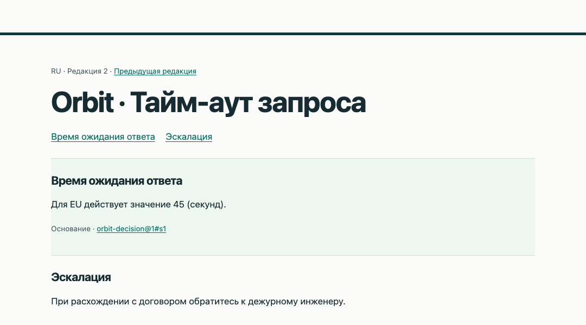

# Agent Wiki Lab

Локальная база знаний, в которой человек и ИИ-агент работают с одними и теми же редакциями документов. Человек открывает статью в браузере, агент читает или предлагает правку через Model Context Protocol (MCP). Ссылка из ответа ведёт к конкретной редакции и разделу, поэтому читатель может проверить основание даже после следующей правки.

В этом проекте я исследовал, где ломается ответ на вопрос по корпоративной документации. Для этого я реализовал wiki, подключил несколько вариантов поиска, задал проверяемый контракт агенту и сравнил его работу с Confluence Cloud через официальный Atlassian MCP. Самое показательное наблюдение — агент иногда находит нужную строку, правильно её цитирует и всё равно возвращает пользователю его же вопрос.



В этой демоверсии агент обновил тайм-аут для EU до 45 секунд. Читатель может открыть предыдущую редакцию с тайм-аутом 90 секунд, перейти к источнику изменения и проверить, что соседний раздел об эскалации сохранился. После клонирования откройте `demo/index.html` в браузере или запустите wiki по инструкции ниже. [Демо](demo/) · [Что изменилось между редакциями](demo/p/orbit-guide/)

## Как устроена wiki

| Сценарий | Реализация |
|---|---|
| Два редактора меняют один раздел | SQLite хранит редакции и историю. Запись проверяет базовую ревизию, а повтор запроса с тем же идентификатором не создаёт вторую правку. [Хранилище](wiki.py) |
| Агент предлагает обновление | MCP выдаёт инструменты по роли. У черновика есть автор, основание и diff. Другой редактор может принять или отклонить предложение. [Инструменты MCP](wiki_mcp.py) · [Согласование](review.py) |
| Человек проверяет источник | Браузер и MCP читают одно хранилище и применяют ограничения доступа. HTML, Markdown, текст и PDF можно импортировать с сохранением исходного файла и контрольной суммы. [Веб-интерфейс](site_view.py) · [Импорт](materials.py) |
| Инженер выбирает поиск | Стенд сравнивает SQLite FTS5, лексический XERJ, multilingual-E5 и объединение рангов через RRF. Есть отдельные эксперименты на полном тексте и на коротких карточках. [Сравнение поиска](benchmark.py) · [Полный текст](fulltext_eval.py) |
| Нужно понять причину ошибки модели | Общий клиент ведёт трассу запросов, чтений, попыток ответа и времени. Отдельный контроль даёт модели заранее выбранные выдержки. Это позволяет проверить, сохранится ли ошибка, когда нужная информация уже в контексте. [Клиент](rovo_read_pilot.py) · [Контроль](evidence_control.py) |

## Последние тесты

**Поиск документов.** На 512 общих страницах заданы 64 английских вопроса из EnterpriseRAG-Bench. XERJ нашёл хотя бы одну эталонную страницу среди первых пяти результатов для **56/64** вопросов, семантический `search` Rovo — для **52/64**. Парный 95%-й bootstrap-интервал для разницы в Hit@5 составил от −1,56 до +14,06 процентного пункта. Он включает ноль. XERJ работал локально, Rovo — через сеть по сайту с ограничением на приложение Confluence. [Все 64 пары, время и параметры](results/rovo-2026-11-22/paired-search.json)

**Ответы агента.** Для 16 вопросов использовались одна локальная Qwen3-4B, одинаковый клиент и лимиты в пять поисков, пять чтений и 180 секунд. Зачёт требовал полного ответа, подтверждения фактов и работающих ссылок. В последней версии модель сначала выделяет подпункты вопроса, а затем указывает источник и короткую дословную цитату для каждого утверждения.

| На 16 задачах | XERJ | Confluence + Rovo |
|---|---:|---:|
| Полный ответ с проверенным источником | 1 | 0 |
| Ответ сдан до дедлайна | 6 | 6 |
| Тайм-ауты | 10 | 10 |
| Всего поисков / чтений | 16 / 37 | 16 / 50 |
| Медиана времени задачи, включая тайм-ауты | 180 с | 180 с |

У предыдущей версии клиента итог также составлял 1/16 и 0/16, при двух и трёх тайм-аутах соответственно. Во всех двадцати новых тайм-аутах клиент хотя бы один раз отклонил попытку сдать ответ. На вопросе про права API обе стороны нашли нужную цитату. В диалоге с XERJ модель назвала оба разрешения за 42 секунды. В диалоге с Rovo модель приложила цитату к строке, которая повторяла вопрос. Этот пример показывает, зачем в оценке отдельно читать то, что увидит пользователь. [Ответы и цитаты](results/agent-policy-v3-2026-11-23/paired/blind.json) · [Оценки](results/agent-policy-v3-2026-11-23/paired/agent-grades.json)

**Контроль с готовыми источниками.** На восьми многодокументных вопросах Qwen3-4B с обычной инструкцией, та же модель с инструкцией по подпунктам и Qwen3-8B с инструкцией по подпунктам полностью решили одни и те же **3/8** задач. Например, пакет содержал четыре подходящих отчёта об инцидентах. Модели дали ответы «два», «три» и «шесть». По трассе видно, как 8B дважды посчитала разные выдержки из одной статьи. У моделей был один запуск на вопрос и условие. [Подробный разбор и ограничения](POLICY-AND-EVIDENCE.md) · [Ответы 8B](results/agent-policy-v3-2026-11-23/oracle-8b/answers.json)

## Быстрый старт

Для демо достаточно Python 3.12 с SQLite FTS5. Оно использует локальные демоданные. Выполните команды из корня репозитория.

```sh
python3.12 app.py init
python3.12 app.py serve --engine sqlite
```

Откройте [локальную wiki](http://127.0.0.1:8765/). Она слушает loopback. Для подключения модели через MCP установите зависимости и зарегистрируйте в MCP-клиенте команду `.venv/bin/python` с аргументами `wiki_mcp.py --role reader`. Для запуска из другого рабочего каталога укажите абсолютные пути к интерпретатору и скрипту.

```sh
uv venv --python 3.12 .venv
uv pip install --python .venv/bin/python -r requirements.txt
.venv/bin/python -m unittest -v
```

## Данные и воспроизведение

Публичный корпус EnterpriseRAG-Bench содержит синтетические корпоративные документы. На полном релизе локальный XERJ проиндексировал **511 962 документа**. Для нагрузочного опыта корпус дополнили синтетическими регламентами до **40 ГБ** исходного текста и **1 657 141 документа**. Сопоставимый замер с Confluence проведён на 512 страницах. [Результат на 40 ГБ](results/retry-2026-11-22/xerj-40gb.json) · [История экспериментов](EXPERIMENTS.md)

[Как воспроизвести тесты](REPRODUCE.md) · [Полный протокол последнего сравнения](POLICY-AND-EVIDENCE.md) · [Датасет и релиз](https://github.com/onyx-dot-app/EnterpriseRAG-Bench/releases/tag/v1.0.0)

Код проекта публикуется под MIT, © 2026 Faso367. Для данных EnterpriseRAG-Bench и выдержек из них действует MIT, © 2026 Onyx. Модели и исполняемые файлы загружаются отдельно. [Лицензия проекта](LICENSE) · [Лицензия данных](LICENSE-EnterpriseRAG-Bench.txt)
